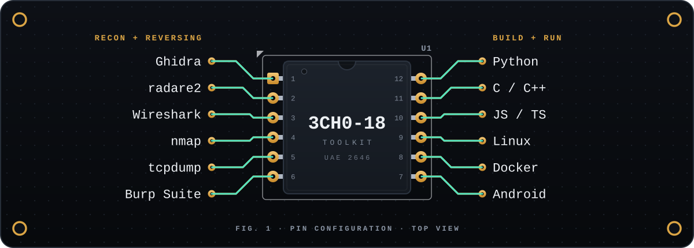

  <a href="https://3cho.org"><picture>
    <source media="(prefers-color-scheme: dark)" srcset="assets/hero-dark.svg">
    <source media="(prefers-color-scheme: light)" srcset="assets/hero-light.svg">
    
  </picture></a>

Hey, I'm **3ch0**. I'm 18, based in the UAE, and I take IoT devices apart to find out how they really work. Firmware, debug ports, locked bootloaders: if a vendor hoped nobody would look there, that's where I start.

I'm just as hooked on AI and cybersecurity, and curious about nearly everything in between. Most recently I spent 13 to 14 November at the **NASA Space Apps Challenge 2026** at the University of Dubai, where my team built [Lumasphere](https://github.com/3ch0less/spaceappsproject).

  <picture>
    <source media="(prefers-color-scheme: dark)" srcset="assets/h-work-dark.svg">
    <source media="(prefers-color-scheme: light)" srcset="assets/h-work-light.svg">
    
  </picture>

  <a href="https://github.com/3ch0less/spaceappsproject"><picture>
    <source media="(prefers-color-scheme: dark)" srcset="assets/card-lumasphere-dark.svg">
    <source media="(prefers-color-scheme: light)" srcset="assets/card-lumasphere-light.svg">
    
  </picture></a>

  <a href="https://github.com/3ch0less/pvg100e-root"><picture>
    <source media="(prefers-color-scheme: dark)" srcset="assets/card-pvg100e-root-dark.svg">
    <source media="(prefers-color-scheme: light)" srcset="assets/card-pvg100e-root-light.svg">
    
  </picture></a>

  <a href="https://github.com/3ch0less/roblox-2016-arm64"><picture>
    <source media="(prefers-color-scheme: dark)" srcset="assets/card-roblox-2016-arm64-dark.svg">
    <source media="(prefers-color-scheme: light)" srcset="assets/card-roblox-2016-arm64-light.svg">
    
  </picture></a>

  <picture>
    <source media="(prefers-color-scheme: dark)" srcset="assets/h-toolkit-dark.svg">
    <source media="(prefers-color-scheme: light)" srcset="assets/h-toolkit-light.svg">
    
  </picture>

  <picture>
    <source media="(prefers-color-scheme: dark)" srcset="assets/toolkit-dark.svg">
    <source media="(prefers-color-scheme: light)" srcset="assets/toolkit-light.svg">
    
  </picture>

  <picture>
    <source media="(prefers-color-scheme: dark)" srcset="assets/footer-dark.svg">
    <source media="(prefers-color-scheme: light)" srcset="assets/footer-light.svg">
    
  </picture>

  <a href="https://3cho.org">3cho.org</a>
  &nbsp;·&nbsp;
  <a href="https://github.com/3ch0less?tab=repositories">all repositories</a>

