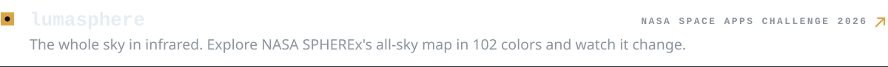
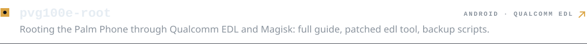
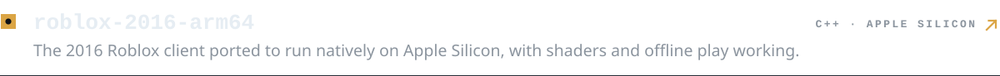
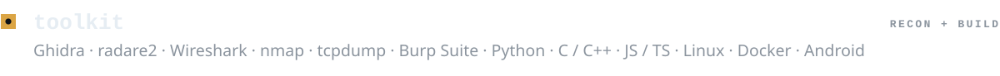

  

I'm **3ch0**, 18, based in the UAE. I take IoT devices apart to find out how they really work: firmware, debug ports, locked bootloaders. I'm just as hooked on AI and cybersecurity, and curious about nearly everything in between.

Most recently: the **NASA Space Apps Challenge 2026** at the University of Dubai (13 to 14 November), where my team built [Lumasphere](https://github.com/3ch0less/spaceappsproject).

  <a href="https://github.com/3ch0less/spaceappsproject"><picture><source media="(prefers-color-scheme: dark)" srcset="assets/row-lumasphere-dark.svg"><source media="(prefers-color-scheme: light)" srcset="assets/row-lumasphere-light.svg"></picture></a>
  <a href="https://github.com/3ch0less/pvg100e-root"><picture><source media="(prefers-color-scheme: dark)" srcset="assets/row-pvg100e-root-dark.svg"><source media="(prefers-color-scheme: light)" srcset="assets/row-pvg100e-root-light.svg"></picture></a>
  <a href="https://github.com/3ch0less/roblox-2016-arm64"><picture><source media="(prefers-color-scheme: dark)" srcset="assets/row-roblox-2016-arm64-dark.svg"><source media="(prefers-color-scheme: light)" srcset="assets/row-roblox-2016-arm64-light.svg"></picture></a>
  <picture><source media="(prefers-color-scheme: dark)" srcset="assets/row-toolkit-dark.svg"><source media="(prefers-color-scheme: light)" srcset="assets/row-toolkit-light.svg"></picture>

  <a href="https://3cho.org">3cho.org</a>
  &nbsp;·&nbsp;
  <a href="https://github.com/3ch0less?tab=repositories">all repositories</a>

